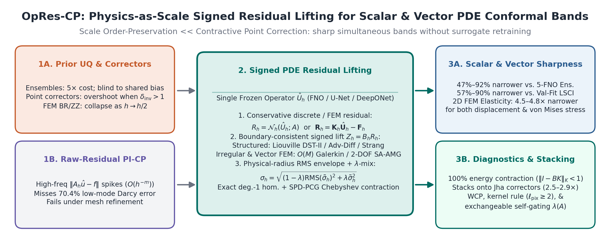

# OpRes-CP: Physics-as-Scale vs. Ensembles-as-Scale

**Signed Residual Lifting for Simultaneous Conformal Bands**

[](LICENSE)
[](https://www.python.org/)
[](https://pytorch.org/)
[](configs/phase3.json)

> **Authors:** [Zida Hao](https://orcid.org/0009-0006-7718-2000)<sup>*</sup>, [Yubo Li](https://orcid.org/0009-0005-8391-9155) — School of Software, Xinjiang University  
> **Repository:** <https://github.com/human-com-h/OpRes-CP>



---

## Core Idea

Given a **single frozen neural operator** $\widehat{U}_h$ without retraining or modifying point predictions, OpRes-CP forms a **signed, boundary-consistent approximate inverse** of the linearized PDE operator acting on the discrete residual $R_h = \mathcal{L}_h(\widehat{U}_h) - f_h$, extracts a physical-radius root-mean-square envelope, and calibrates a split-conformal simultaneous $L^\infty$ band:

$$R_h \;\longrightarrow\; Z_h = B_h R_h \;\longrightarrow\; s_h(x) = \sqrt{\big(K_{\ell_{\rm phys}} * Z_h^2\big)(x) + \big(\rho_{\rm rel}\,\mathrm{RMS}(Z_h)\big)^2}, \quad \sigma_h(x) = \sqrt{(1-\lambda)\,\mathrm{RMS}(s_h)^2 + \lambda\,s_h(x)^2}$$

Because split conformal calibration fits $\widehat{q}_{1-\alpha}$ over $S_i = \max_{x \in I_h} |e_i(x)| / \sigma_i(x)$, conformal sharpness requires only **scale order-preservation** rather than operator contraction:

$$\text{Scale Order-Preservation } \big(\|I - B_h A_h\| \text{ may exceed } 1\big) \;\ll\; \text{Contractive Point Correction } \big(\delta_{\rm inv} = \|B_h A_h - I\| < 1\big)$$

---

## Headline Five-Seed Results ($\alpha = 0.10$, $90\%$ Nominal Simultaneous Coverage)

All metrics below are means across the five locked seeds `[42, 137, 314, 271, 811]` against a five-member independent ensemble (`mean center`) trained with identical architecture and schedule:

| Benchmark | PDE & Lift $B_h$ | OpRes-CP ID Cov. | OpRes-CP m90 Width | 5-Ens. m90 Width | Width Reduction / Narrowing | Train Cost (1 vs. 5) |
|---|---|---:|---:|---:|---:|---:|
| **2D Darcy ($64^2$)** | Heterogeneous diffusion, DST-II Liouville | `90.20%` | `0.01731` | `0.05391` | **67.54% narrower** (`3.11x`) | `21.4%` (`78.8s` vs `367.6s`) |
| **1D Burgers ($64$)** | Viscous transport, Causal Semi-Lagrangian | `90.00%` | `0.13934` | `0.26484` | **47.40% narrower** (`1.90x`) | `22.6%` (`33.7s` vs `149.4s`) |
| **2D Allen–Cahn ($64^2, T=1$)** | Reaction–diffusion, Strang Jacobian lift | `88.68%` | `0.01027` | `0.13651` | **92.48% narrower** (`13.29x`) | `20.7%` (`76.3s` vs `368.6s`) |
| **L-Shape Darcy ($64^2$)** | Re-entrant domain, $O(M)$ `AMG-PCG2` | `90.40%` | `0.01019` | `0.03254` | **68.61% narrower** (`3.19x`) | `20.2%` (`20.4s` vs `100.6s`) |
| **2D Elasticity ($P_1$ FEM, Disp.)** | Perforated plate, 2-DOF `Vector SA-AMG-V2` | `88.96%` | `0.20599` | `0.98926` | **79.18% narrower** (`4.80x`) | `20.9%` (`12.6s` vs `60.4s`) |
| **2D Elasticity ($P_1$ FEM, vM Stress)** | Gâteaux stress proxy via `Vector SA-AMG-V2` | `89.52%` | `1.86267` | `8.44022` | **77.93% narrower** (`4.53x`) | *(shared surrogate)* |

- Warm single-case end-to-end T4 speedups: **1.1–4.2x** over 5-member ensembles and **7.8–29.0x** over $K=30$ MC-Dropout (GPU-resident Allen–Cahn $128^2$ reaches **3.64–4.03x** batched speedup on RTX 4060).
- On 2D Elasticity ($\mathcal{T}_c \to \mathcal{T}_f$), `Vector SA-AMG-V2` achieves **100.0% empirical energy contraction** ($\|I - B_h \mathbf{K}_h\|_{\mathbf{K}_h} < 1$) across all five seeds and splits, avoids the fine-mesh collapse of classical Babuška–Rheinboldt and Zienkiewicz–Zhu estimators, and orthogonally sharpens contractive Jha-style point correctors by **2.5–2.9x**.

---

## Quickstart (Three-Tier Reproducibility)

### Environment Setup

```bash
conda env create -f environment.yml
conda activate opres-cp
# or with pip:
pip install -r requirements.txt
```

### Tier 1 — 30-Second CPU-Only Self-Check (Zero Weights Required)

Validates `configs/phase3.json` SHA-256, 2D unstructured $P_1$ FEM Patch Test + Gâteaux stress derivative + `Vector SA-AMG-V2` contraction (`--unit-only`), `SPD-AMG-PCG2` positive homogeneity ($<10^{-13}$) and Chebyshev bound (Proposition 2), structured PDE operator smoke checks (Darcy DST-II, Burgers causal SL, Allen–Cahn Strang), and summary JSON consistency:

```bash
python -X utf8 tests/quick_verify.py
```

### Tier 2 — Zero-Retraining Table & Figure Reconstruction

Rebuilds the publication booktabs `.tex` tables and diagnostic figures (`fig7`–`fig10`, `graphical_abstract`) directly from the committed five-seed summary JSONs into `outputs/tables/` and `outputs/figures/`:

```bash
python -X utf8 scripts/reproduce_summary_artifacts.py
```

### Tier 3 — Full Sealed Five-Seed Replay & From-Scratch Training

#### 3A. Download and SHA-256 Verify Frozen Release Assets

```bash
# From GitHub Release v1.0.0 (default: human-com-h/OpRes-CP)
python -X utf8 scripts/download_artifacts.py

# Or from Zenodo once the v1.0.0 DOI is minted:
python -X utf8 scripts/download_artifacts.py --source zenodo --zenodo-base-url https://zenodo.org/records/<RECORD_ID>/files
```

#### 3B. Official 12 Appendix B.3 Replay Commands (Read-Only Against Frozen Weights)

```bash
python -X utf8 scripts/phase2d_summarize.py --require-complete
python -X utf8 scripts/phase2d_verify.py
python -X utf8 scripts/phase3_summarize.py
python -X utf8 scripts/phase3_revision.py
python -X utf8 scripts/phase3_revision_v2.py
python -X utf8 scripts/phase3_revision_v3.py
python -X utf8 scripts/phase3_revision_v4.py --tasks 1 2 3 tf
python -X utf8 scripts/phase3_figures.py
python -X utf8 scripts/phase3_tables.py
python -X utf8 scripts/rev3_tables_figures.py
python -X utf8 scripts/rev4_tables_figures.py
python -X utf8 scripts/rev3_cmame_check.py
```

#### 3C. From-Scratch Training & Full Benchmark Execution

| Benchmark | Command (Single Seed / Five Seeds) | Approximate Wall Time |
|---|---|---|
| **2D Elasticity $P_1$ FEM** (5 seeds + `VectorDeepONet` + `Vector SA-AMG-V2`) | `python -X utf8 scripts/rev4_task1_elasticity_fem.py --workers 6` | ~15 min (RTX 4060 / 6 CPU workers) |
| **L-shape 2D Darcy AMG** (5 seeds + `LShapeFNO`) | `python -X utf8 scripts/phase3_p2_lshape_amg.py` | ~12 min (1 GPU) |
| **2D Darcy $64^2$/$32^2$** (single seed `42`, data + FNO/U-Net/DeepONet/Ens) | `python -X utf8 scripts/darcy_phase2.py --seed 42` | ~8 min (T4/RTX 4060) |
| **1D Burgers $64$** (single seed `42`, data + FNO/U-Net/DeepONet/Ens) | `python -X utf8 scripts/burgers_phase2.py --seed 42` | ~4 min (T4/RTX 4060) |
| **2D Allen–Cahn $64^2$** (single seed `42`, data + StepFNO/StepUNet/Ens) | `python -X utf8 scripts/allen_cahn_phase2_formal.py --seed 42` | ~12 min (T4/RTX 4060) |

---

## Repository Map & Mapping to Paper Tables / Figures

```text
OpRes-CP/
├── assets/graphical_abstract.png       # Manuscript Graphical Abstract
├── configs/*.json                      # 8 locked experimental & ablation specifications
├── results/                            # Committed five-seed summary JSON/CSV & frozen manifests
├── scripts/                            # 54 core experiment/audit/plotting scripts + helpers
│   ├── download_artifacts.py           # Tier 3 GitHub/Zenodo artifact downloader & SHA-256 verifier
│   └── reproduce_summary_artifacts.py  # Tier 2 zero-weight table & figure builder
├── tests/quick_verify.py               # Tier 1 <30s CPU self-check
├── SHA256SUMS.txt                      # SHA-256 digest manifest (configs, summaries, release tars)
├── CITATION.cff                        # GitHub citation metadata (CFF 1.2.0)
├── requirements.txt / environment.yml  # Exact dependency specifications
└── LICENSE                             # MIT License
```

| Manuscript Table / Figure | Script(s) | Output Location (in this repo) |
|---|---|---|
| **Table 1** (`tab:opres-positioning`, Method Positioning) | `scripts/rev4_tables_figures.py` | `outputs/tables/rev4_sec2_positioning.tex` |
| **Table 2–3** (`tab:opres-id`, `tab:opres-runtime`, `tab:opres-ood`, `tab:opres-grid`, `tab:opres-horizon`) | `scripts/phase3_tables.py` + `scripts/rev3_tables_figures.py` | `outputs/tables/phase3_main_tables.tex` |
| **Table 4** (`tab:opres-all-baselines`, `tab:opres-cross-arch`) | `scripts/phase3_tables.py` + `scripts/rev3_tables_figures.py` | `outputs/tables/phase3_promoted_tables.tex` |
| **Tables 5–8** (`tab:opres-fidelity`, `tab:opres-signed-recovery`, `tab:opres-op-approx`, `tab:opres-freq-bands`) | `scripts/rev2_tables_figures.py` -> `rev3_tables_figures.py` -> `rev4_tables_figures.py` | `outputs/tables/phase3_rev2_main_tables.tex` |
| **Table 9** (`tab:opres-lshape`) | `scripts/phase3_p2_lshape_amg.py` + `scripts/phase3_tables.py` | `outputs/tables/phase3_p2_lshape_table.tex` |
| **Tables 10–11** (`tab:opres-elasticity`, `tab:opres-nonlinear-jha`) | `scripts/rev4_tables_figures.py` | `outputs/tables/rev4_main_tables.tex` |
| **Table 13 / App. Table B.12** (`tab:opres-backbones`, `tab:opres-data-spec`, `tab:opres-elasticity-amg`, `tab:opres-time-conv`, `tab:opres-physics-gate`) | `scripts/rev4_tables_figures.py` | `outputs/tables/rev4_appendix_tables.tex` |
| **Appendix C Tables** (`tab:opres-lsci`, `tab:opres-lsci-fair`, `tab:opres-wcp-split`, `tab:opres-oodb-amg`, `tab:opres-gamma-ablation`, `tab:opres-kernel-scan`, `tab:opres-temporal-wcp`, `tab:opres-fidelity-ood`–`tab:opres-amg-scaling`) | `scripts/phase3_tables.py`, `rev2_tables_figures.py`, `rev3_tables_figures.py` | `outputs/tables/phase3_ablation_tables.tex`, `phase3_revision_tables.tex`, `phase3_rev3_tables.tex`, `phase3_rev2_appendix_tables.tex` |
| **Figures 1–5** (`fig1_physics_scale`–`fig5_frozen_ablations`) | `scripts/phase3_figures.py` | `outputs/figures/fig1_*.pdf`–`fig5_*.pdf` |
| **Figure 6** (`fig6_lshape_amg`) | `scripts/phase3_p2_lshape_amg.py` | `outputs/figures/fig6_lshape_amg.pdf` |
| **Figures 7–8** (`fig7_fidelity_bands`, `fig8_stress_and_amg`) | `scripts/rev2_tables_figures.py` + `scripts/rev4_tables_figures.py` | `outputs/figures/fig7_*.pdf`, `fig8_*.pdf` |
| **Figure 9** (`fig9_rev3_diagnostics`) | `scripts/rev3_tables_figures.py` | `outputs/figures/fig9_rev3_diagnostics.pdf` |
| **Figure 10** (`fig10_elasticity_fem`) | `scripts/rev4_tables_figures.py` | `outputs/figures/fig10_elasticity_fem.pdf` |

---

## Hardware & Determinism Notes

- **Formal Seeds:** `[42, 137, 314, 271, 811]` (locked across all five-seed experiments).
- **Precision:** All surrogate backbones train and evaluate in `float32` with TensorFloat-32 disabled (`torch.backends.cuda.matmul.allow_tf32 = False`, `torch.backends.cudnn.allow_tf32 = False`); PDE discrete operators, AMG hierarchies, and FEM assembly run in `float64`.
- **Locked Phase 3 Ablation Config SHA-256 (`configs/phase3.json`):**
  ```text
  f241e0d197c57a348219d9756d7a7f01f794d63c7f431f926ba993bb3c37c363
  ```
- **Frozen Replay Parity:** Across all 110 parent method–split–level comparisons, frozen replay reproduces identical simultaneous coverage with maximum relative width discrepancy `8.45e-8`.

---

## Citation

```bibtex
@misc{hao2026oprescp,
  title  = {Physics-as-Scale vs. Ensembles-as-Scale: Signed Residual Lifting for Simultaneous Conformal Bands},
  author = {Hao, Zida and Li, Yubo},
  year   = {2026},
  url    = {https://github.com/human-com-h/OpRes-CP}
}
```
